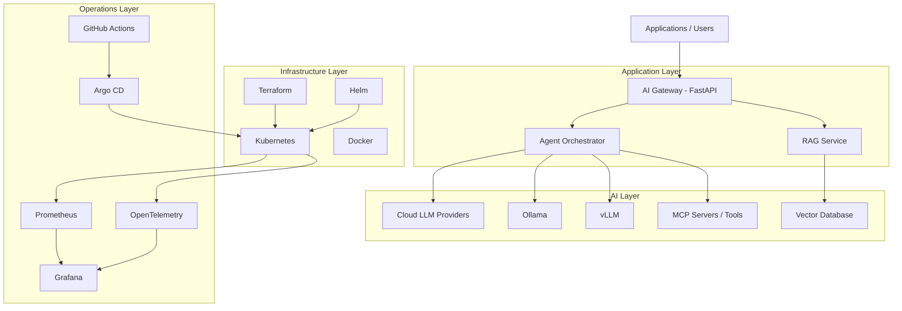

# AI Infrastructure Engineer — Learning Roadmap

> **Personal Learning Path | DevOps · Cloud · AI Engineering · LLMOps**
>
> Objectif : développer progressivement les compétences nécessaires pour devenir un ingénieur DevOps / Platform Engineering spécialisé dans les infrastructures et applications d'intelligence artificielle.

---

# 1. Objectif du parcours

Ce dépôt constitue mon parcours personnel de montée en compétences techniques.

Je souhaite évoluer vers un profil capable de concevoir, développer, déployer, automatiser, sécuriser et superviser des applications intégrant de l'intelligence artificielle.

L'objectif n'est pas de devenir Data Scientist ou Machine Learning Engineer spécialisé dans l'entraînement de modèles, mais de maîtriser les technologies qui permettent de transformer des modèles IA en véritables services exploitables en production.

### Compétences finales recherchées

- Administration système Linux et réseaux.
- Architecture Cloud et infrastructures distribuées.
- Conteneurisation et orchestration Kubernetes.
- Infrastructure as Code et automatisation.
- CI/CD et DevSecOps.
- Développement d'applications et d'APIs IA.
- LLM, RAG, Agents et MCP.
- Déploiement et serving de modèles.
- MLOps et LLMOps.
- Observabilité, monitoring et sécurité des systèmes IA.

**Positionnement visé :**

`DevOps Engineer → Platform Engineer → AI Infrastructure / LLMOps Engineer`

### Méthode d'apprentissage

Le parcours repose sur trois principes :

1. Apprendre les concepts fondamentaux avant les technologies avancées.
2. Valider les compétences avec des formations, exercices et credentials.
3. Mettre progressivement les connaissances en pratique avant de construire le projet final.

Priorité aux formations et credentials gratuits. Les examens professionnels payants seront envisagés ultérieurement lorsque leur valeur professionnelle le justifie.

---

# 2. Roadmap des formations et certifications

Le parcours est organisé en 6 étapes chronologiques.

Chaque étape possède un objectif pédagogique, des ressources à suivre et des compétences à valider.

## ÉTAPE 01 — Linux, systèmes et Cloud Fundamentals

**Objectif : maîtriser les fondations de l'infrastructure.**

Avant de travailler sur Kubernetes ou les infrastructures IA, il est indispensable de comprendre les systèmes sur lesquels reposent ces technologies.

### 1. Linux Foundation — Introduction to Linux

- [ ] Terminer la formation.
- [ ] Comprendre l'architecture Linux.
- [ ] Maîtriser le terminal et le shell.
- [ ] Gérer utilisateurs, groupes et permissions.
- [ ] Administrer les services et processus.
- [ ] Comprendre les systèmes de fichiers.
- [ ] Utiliser SSH et les commandes réseau.

Ressource : https://training.linuxfoundation.org/training/introduction-to-linux/

### 2. AWS Skill Builder — Cloud Practitioner Essentials

- [ ] Comprendre les concepts du Cloud Computing.
- [ ] Découvrir IaaS, PaaS et SaaS.
- [ ] Comprendre les régions et zones de disponibilité.
- [ ] Découvrir les services de calcul, stockage et réseau.
- [ ] Comprendre les principes de sécurité Cloud.
- [ ] Comprendre la facturation et la gestion des coûts.

Ressource : https://skillbuilder.aws/

### 3. Cisco Skills for All — Networking Basics

- [ ] Comprendre les modèles réseau.
- [ ] Maîtriser les bases TCP/IP.
- [ ] Comprendre DNS, DHCP et HTTP.
- [ ] Comprendre le routage et les sous-réseaux.
- [ ] Découvrir les principes de sécurité réseau.

Ressource : https://skillsforall.com/

### Compétences à valider

À la fin de cette étape, je dois être capable d'administrer un serveur Linux, de comprendre son fonctionnement et d'expliquer les bases d'une infrastructure Cloud et réseau.

---

## ÉTAPE 02 — Docker, Kubernetes et Infrastructure as Code

**Objectif : maîtriser la conteneurisation et l'orchestration.**

Cette étape constitue le socle technique du futur projet d'infrastructure IA.

### 4. Docker — Docker Getting Started

- [ ] Comprendre les conteneurs.
- [ ] Créer des Dockerfiles.
- [ ] Construire des images.
- [ ] Utiliser Docker Compose.
- [ ] Gérer les volumes et réseaux.
- [ ] Publier des images dans un registre.
- [ ] Comprendre les bonnes pratiques de conteneurisation.

Ressource : https://docs.docker.com/get-started/

### 5. Linux Foundation — Introduction to Kubernetes

- [ ] Comprendre l'architecture Kubernetes.
- [ ] Maîtriser Pods, Deployments et ReplicaSets.
- [ ] Comprendre Services et Ingress.
- [ ] Utiliser ConfigMaps et Secrets.
- [ ] Comprendre les volumes persistants.
- [ ] Maîtriser les namespaces.
- [ ] Découvrir RBAC et les mécanismes de sécurité.
- [ ] Comprendre le scheduling des workloads.

Ressource : https://training.linuxfoundation.org/training/introduction-to-kubernetes/

### 6. HashiCorp — Terraform Tutorials

- [ ] Comprendre Infrastructure as Code.
- [ ] Utiliser les providers.
- [ ] Déclarer des ressources.
- [ ] Manipuler variables et outputs.
- [ ] Comprendre le Terraform State.
- [ ] Créer des modules réutilisables.
- [ ] Gérer les environnements.

Ressource : https://developer.hashicorp.com/terraform/tutorials

### 7. Kubernetes — Helm Documentation

- [ ] Comprendre les charts Helm.
- [ ] Créer un chart.
- [ ] Gérer les valeurs de configuration.
- [ ] Installer et mettre à jour des releases.
- [ ] Gérer les environnements avec plusieurs values files.

Ressource : https://helm.sh/docs/

### Compétences à valider

À la fin de cette étape, je dois pouvoir conteneuriser une application, la déployer sur Kubernetes et automatiser la création d'une infrastructure avec Terraform.

---

## ÉTAPE 03 — CI/CD, GitOps et DevSecOps

**Objectif : automatiser et sécuriser le cycle de développement.**

Une application ne doit pas être seulement fonctionnelle : elle doit pouvoir être testée, construite, déployée et maintenue de manière fiable.

### 8. GitHub Skills — GitHub Actions

- [ ] Comprendre les workflows.
- [ ] Configurer les triggers.
- [ ] Utiliser jobs et steps.
- [ ] Gérer les variables et secrets.
- [ ] Créer des pipelines de tests.
- [ ] Construire et publier des images Docker.
- [ ] Automatiser des déploiements.

Ressource : https://skills.github.com/

### 9. Microsoft Applied Skills — Secure a CI/CD Pipeline with GitHub Actions

- [ ] Comprendre les risques liés aux pipelines.
- [ ] Sécuriser les permissions.
- [ ] Gérer les secrets.
- [ ] Appliquer le principe du moindre privilège.
- [ ] Sécuriser les dépendances et artefacts.
- [ ] Mettre en place des contrôles de sécurité.

Ressource : https://learn.microsoft.com/en-us/credentials/applied-skills/

*Vérifier le titre exact du parcours disponible et ses conditions d'évaluation avant inscription.*

### 10. Argo CD — Getting Started

- [ ] Comprendre GitOps.
- [ ] Installer Argo CD.
- [ ] Synchroniser un dépôt Git.
- [ ] Déployer une application Kubernetes.
- [ ] Comprendre les stratégies de synchronisation.
- [ ] Découvrir les mécanismes de rollback.

Ressource : https://argo-cd.readthedocs.io/

### 11. Trivy — Vulnerability Scanning

- [ ] Scanner des images Docker.
- [ ] Identifier les vulnérabilités.
- [ ] Scanner les dépendances.
- [ ] Scanner les configurations IaC.
- [ ] Intégrer Trivy dans un pipeline CI/CD.

Ressource : https://trivy.dev/

### Compétences à valider

À la fin de cette étape, je dois être capable de construire une chaîne CI/CD complète, sécurisée et capable de déployer automatiquement une application sur Kubernetes.

---

## ÉTAPE 04 — AI Engineering, LLM, RAG et Agents

**Objectif : apprendre à développer des applications exploitant des modèles d'intelligence artificielle.**

C'est ici que commence la spécialisation IA.

Il ne s'agit pas seulement de savoir appeler une API, mais de comprendre les architectures nécessaires pour construire des applications intelligentes et fiables.

### 12. Hugging Face — AI Agents Course

- [ ] Comprendre le fonctionnement des agents IA.
- [ ] Découvrir les architectures agentiques.
- [ ] Utiliser smolagents.
- [ ] Découvrir LangGraph.
- [ ] Comprendre les outils et le Tool Calling.
- [ ] Construire des agents.
- [ ] Comprendre l'orchestration.
- [ ] Évaluer les performances des agents.
- [ ] Réaliser les exercices et le projet final.

Ressource : https://huggingface.co/learn/agents-course/

**Validation :** obtenir le certificat de complétion selon les conditions du cours.

### 13. OpenAI API — Developer Documentation

- [ ] Comprendre les APIs LLM.
- [ ] Gérer les tokens et context windows.
- [ ] Implémenter le streaming.
- [ ] Utiliser Structured Outputs.
- [ ] Implémenter Function Calling.
- [ ] Gérer les erreurs et timeouts.
- [ ] Suivre les coûts et la consommation.
- [ ] Comprendre les mécanismes d'évaluation.

Ressource : https://developers.openai.com/api/docs/

### 14. Hugging Face — MCP Course

- [ ] Comprendre le Model Context Protocol.
- [ ] Découvrir les clients et serveurs MCP.
- [ ] Créer un serveur MCP.
- [ ] Exposer des outils.
- [ ] Connecter un agent à un serveur MCP.
- [ ] Comprendre les mécanismes de communication.
- [ ] Découvrir les problématiques de sécurité.

Ressource : https://huggingface.co/learn/mcp-course/

### 15. RAG — LangChain Documentation

- [ ] Comprendre les embeddings.
- [ ] Comprendre le découpage documentaire.
- [ ] Créer un pipeline d'indexation.
- [ ] Utiliser une base vectorielle.
- [ ] Implémenter une recherche sémantique.
- [ ] Construire un système RAG.
- [ ] Évaluer la qualité des résultats.

Ressource : https://docs.langchain.com/

### Compétences à valider

À la fin de cette étape, je dois être capable de développer une application IA avec des agents, des outils externes, une API LLM et un système RAG.

---

## ÉTAPE 05 — LLMOps, MLOps et Model Serving

**Objectif : apprendre à déployer et exploiter des modèles IA.**

Une application IA en production nécessite davantage qu'une API connectée à un fournisseur externe.

Il faut comprendre comment servir les modèles, gérer leurs ressources et mesurer leurs performances.

### 16. Ollama — Documentation

- [ ] Installer Ollama.
- [ ] Télécharger et exécuter des modèles.
- [ ] Utiliser son API.
- [ ] Configurer les modèles.
- [ ] Comprendre les contraintes matérielles.
- [ ] Conteneuriser Ollama.

Ressource : https://docs.ollama.com/

### 17. vLLM — Documentation

- [ ] Comprendre le fonctionnement de vLLM.
- [ ] Déployer un serveur d'inférence.
- [ ] Utiliser une API compatible OpenAI.
- [ ] Comprendre le batching.
- [ ] Découvrir le continuous batching.
- [ ] Comprendre la gestion de la mémoire GPU.
- [ ] Mesurer le débit et la latence.
- [ ] Déployer vLLM sur Kubernetes.

Ressource : https://docs.vllm.ai/

### 18. MLflow — Getting Started

- [ ] Comprendre le suivi des expériences.
- [ ] Enregistrer les paramètres et métriques.
- [ ] Gérer les versions de modèles.
- [ ] Découvrir le Model Registry.
- [ ] Comprendre le cycle de vie d'un modèle.

Ressource : https://mlflow.org/docs/latest/

### 19. KServe — Documentation

- [ ] Comprendre l'architecture KServe.
- [ ] Déployer un modèle sur Kubernetes.
- [ ] Configurer un service d'inférence.
- [ ] Comprendre les ressources nécessaires.
- [ ] Découvrir l'autoscaling.
- [ ] Comprendre les stratégies de déploiement.

Ressource : https://kserve.github.io/website/

### 20. NVIDIA — Deep Learning Institute

- [ ] Comprendre les bases du calcul GPU.
- [ ] Découvrir les architectures d'inférence.
- [ ] Comprendre la quantification.
- [ ] Découvrir l'optimisation des modèles.
- [ ] Comprendre les contraintes mémoire et matérielles.

Ressource : https://www.nvidia.com/en-us/training/

### Compétences à valider

À la fin de cette étape, je dois pouvoir déployer un modèle IA localement, exposer une API d'inférence, mesurer ses performances et comprendre comment l'intégrer dans une infrastructure Kubernetes.

---

## ÉTAPE 06 — Observability, Security et Production Engineering

**Objectif : rendre les applications IA fiables, sécurisées et exploitables en production.**

### 21. OpenTelemetry — Documentation et cours

- [ ] Comprendre les traces distribuées.
- [ ] Comprendre les métriques.
- [ ] Comprendre la collecte des logs.
- [ ] Instrumenter une application Python.
- [ ] Tracer les appels aux modèles.
- [ ] Suivre les appels des agents et des outils.
- [ ] Exporter les données vers un backend d'observabilité.

Ressource : https://opentelemetry.io/docs/

### 22. Prometheus — Getting Started

- [ ] Comprendre le modèle de collecte.
- [ ] Configurer des exporters.
- [ ] Créer des métriques applicatives.
- [ ] Utiliser PromQL.
- [ ] Configurer des alertes.

Ressource : https://prometheus.io/docs/introduction/overview/

### 23. Grafana — Fundamentals

- [ ] Connecter une source de données.
- [ ] Créer des dashboards.
- [ ] Construire des visualisations.
- [ ] Configurer des alertes.
- [ ] Superviser les performances des services.

Ressource : https://grafana.com/docs/

### 24. OWASP — Top 10 for LLM Applications

- [ ] Comprendre les Prompt Injections.
- [ ] Étudier les risques liés aux outils des agents.
- [ ] Comprendre les risques d'exposition de données.
- [ ] Sécuriser les sorties des modèles.
- [ ] Contrôler les permissions des agents.
- [ ] Mettre en place des validations humaines.
- [ ] Étudier les risques liés aux dépendances et modèles.

Ressource : https://genai.owasp.org/

### Compétences à valider

À la fin de cette étape, je dois pouvoir superviser une application IA, analyser ses performances, comprendre ses risques de sécurité et mettre en place les mécanismes nécessaires à son exploitation.

---

# 3. Vue d'ensemble de la progression

| Étape | Domaine | Résultat attendu |
|---|---|---|
| 01 | Linux / Cloud / Réseau | Maîtriser les fondamentaux |
| 02 | Docker / Kubernetes / Terraform | Construire une infrastructure |
| 03 | CI/CD / GitOps / DevSecOps | Automatiser et sécuriser |
| 04 | LLM / Agents / RAG / MCP | Développer des applications IA |
| 05 | LLMOps / MLOps / Serving | Déployer des modèles |
| 06 | Observability / Security | Exploiter en production |

**Progression pédagogique :**

`Comprendre → Construire → Automatiser → Développer → Déployer → Superviser`

---

# 4. Projet final — AI Infrastructure Platform

Une fois les six étapes terminées, l'objectif est de mettre en pratique l'ensemble des compétences acquises au travers d'un projet technique complet.

## Présentation

AI Infrastructure Platform est une plateforme personnelle permettant de déployer, exposer, administrer et superviser différents modèles et services d'intelligence artificielle.

L'objectif est de construire une infrastructure similaire à celle que pourrait utiliser une équipe Platform Engineering ou AI Infrastructure.

Ce projet doit démontrer ma capacité à prendre en charge le cycle de vie complet d'une application IA : développement, intégration, déploiement, sécurisation et supervision.

Il ne s'agit pas de construire un simple chatbot, mais une véritable plateforme technique.

## 4.1. Model Serving

Permettre d'héberger différents modèles IA.

- [ ] Support Ollama.
- [ ] Support vLLM.
- [ ] Déploiement de modèles locaux.
- [ ] APIs d'inférence.
- [ ] Gestion des versions.
- [ ] Configuration des paramètres.
- [ ] Gestion CPU / RAM / GPU.
- [ ] Mesure de la latence.
- [ ] Mesure du débit.
- [ ] Comparaison des performances.

## 4.2. AI Gateway

Développer une API centralisée permettant aux applications de communiquer avec différents fournisseurs et modèles.

- [ ] API centralisée avec FastAPI.
- [ ] Routage entre différents modèles.
- [ ] Gestion des fournisseurs externes.
- [ ] Gestion sécurisée des clés API.
- [ ] Authentification.
- [ ] Rate limiting.
- [ ] Gestion des quotas.
- [ ] Comptabilisation des tokens.
- [ ] Suivi des coûts.
- [ ] Gestion des erreurs et timeouts.
- [ ] Fallback entre modèles.

## 4.3. Agents et MCP

Permettre aux applications de créer des agents capables d'utiliser différents outils.

- [ ] Création d'agents.
- [ ] Configuration des instructions.
- [ ] Sélection du modèle.
- [ ] Function Calling.
- [ ] Support MCP.
- [ ] Création de serveurs MCP personnalisés.
- [ ] Gestion des outils autorisés.
- [ ] Gestion des permissions.
- [ ] Validation des actions sensibles.
- [ ] Historique des exécutions.
- [ ] Tracing des appels aux outils.

## 4.4. RAG et Knowledge Management

Permettre aux modèles de travailler avec des connaissances externes.

- [ ] Import de documents.
- [ ] Extraction de contenu.
- [ ] Chunking.
- [ ] Génération d'embeddings.
- [ ] Stockage vectoriel.
- [ ] Recherche sémantique.
- [ ] Récupération du contexte.
- [ ] Génération de réponses contextualisées.
- [ ] Évaluation de la pertinence.

## 4.5. Infrastructure et déploiement

- [ ] Conteneurisation Docker.
- [ ] Déploiement Kubernetes.
- [ ] Helm.
- [ ] Terraform.
- [ ] Gestion des environnements.
- [ ] Gestion des secrets.
- [ ] Gestion des ressources.
- [ ] Autoscaling lorsque pertinent.
- [ ] Déploiements reproductibles.

## 4.6. CI/CD et GitOps

- [ ] GitHub Actions.
- [ ] Tests unitaires.
- [ ] Tests d'intégration.
- [ ] Tests des agents.
- [ ] Analyse de sécurité.
- [ ] Build des images.
- [ ] Publication dans un registre.
- [ ] Déploiement Kubernetes.
- [ ] Argo CD.
- [ ] Rollback.

## 4.7. Observability

- [ ] Prometheus.
- [ ] Grafana.
- [ ] OpenTelemetry.
- [ ] Centralisation des logs.
- [ ] Distributed Tracing.
- [ ] Monitoring des APIs.
- [ ] Latence des modèles.
- [ ] Consommation des tokens.
- [ ] Taux d'erreur.
- [ ] Disponibilité des services.
- [ ] Utilisation CPU / RAM / GPU.
- [ ] Coûts d'inférence.
- [ ] Alerting.

## 4.8. Security

- [ ] Gestion des secrets.
- [ ] Authentification et autorisation.
- [ ] RBAC Kubernetes.
- [ ] Principe du moindre privilège.
- [ ] Isolation des environnements.
- [ ] Validation des entrées et sorties.
- [ ] Protection contre les Prompt Injections.
- [ ] Permissions des agents.
- [ ] Validation humaine des actions sensibles.
- [ ] Audit des exécutions.
- [ ] Tests de sécurité automatisés.

---

# 5. Architecture technique envisagée

L'architecture sera développée progressivement, en commençant par un service simple avant de passer à une infrastructure distribuée.

| Domaine | Technologies |
|---|---|
| Backend | Python, FastAPI |
| Frontend éventuel | Vue / Nuxt |
| IA | OpenAI API, Hugging Face |
| Agents | LangGraph, smolagents |
| Protocole | MCP |
| RAG | Embeddings, PostgreSQL / pgvector |
| Serving | Ollama, vLLM |
| Conteneurisation | Docker |
| Orchestration | Kubernetes |
| Packaging | Helm |
| Infrastructure as Code | Terraform |
| CI/CD | GitHub Actions |
| GitOps | Argo CD |
| MLOps | MLflow, KServe |
| Monitoring | Prometheus, Grafana |
| Observability | OpenTelemetry |
| Sécurité | RBAC, Trivy, gestion des secrets |

### Architecture logique



---

# 6. Critères de réussite du projet

Le projet sera considéré comme abouti lorsque :

- [ ] Plusieurs modèles IA peuvent être utilisés.
- [ ] Une API centralisée permet d'y accéder.
- [ ] Des agents peuvent utiliser des outils externes.
- [ ] MCP est intégré.
- [ ] Un système RAG fonctionne.
- [ ] Les services sont conteneurisés.
- [ ] L'infrastructure est reproductible.
- [ ] Les déploiements sont automatisés.
- [ ] Les performances sont mesurables.
- [ ] Les coûts et tokens sont suivis.
- [ ] Les applications sont supervisées.
- [ ] Les accès et secrets sont sécurisés.
- [ ] Les tests sont intégrés dans le pipeline.
- [ ] La documentation permet à une autre personne de déployer la plateforme.

Le résultat attendu est une plateforme démontrable, documentée et reproductible, qui constitue un véritable projet portfolio professionnel.

---

# 7. Organisation du dépôt

```text
ai-infrastructure-platform/
│
├── README.md
│
├── roadmap/
│   ├── step-01-linux-cloud.md
│   ├── step-02-kubernetes-iac.md
│   ├── step-03-devsecops.md
│   ├── step-04-ai-engineering.md
│   ├── step-05-llmops.md
│   └── step-06-observability.md
│
├── labs/
│   ├── linux/
│   ├── networking/
│   ├── docker/
│   ├── kubernetes/
│   ├── terraform/
│   ├── cicd/
│   ├── agents/
│   ├── mcp/
│   ├── rag/
│   ├── model-serving/
│   └── observability/
│
├── platform/
│   ├── backend/
│   ├── frontend/
│   ├── ai-gateway/
│   ├── agents/
│   ├── rag/
│   └── mcp-servers/
│
├── infrastructure/
│   ├── docker/
│   ├── kubernetes/
│   ├── helm/
│   └── terraform/
│
├── observability/
│   ├── prometheus/
│   ├── grafana/
│   └── opentelemetry/
│
├── security/
│   ├── policies/
│   └── tests/
│
├── .github/
│   └── workflows/
│
└── docs/
    ├── architecture/
    ├── decisions/
    └── deployment/
```

---

# 8. Règles de progression

Pour chaque formation :

1. Suivre la documentation officielle.
2. Réaliser les exercices.
3. Reproduire les manipulations sans tutoriel.
4. Documenter les notions importantes.
5. Réaliser un laboratoire personnel.
6. Valider le credential lorsqu'il existe.
7. Passer à l'étape suivante.

Une formation terminée ne signifie pas automatiquement qu'une compétence est acquise.

Chaque technologie doit être comprise et manipulée concrètement.

**Objectif final :** être capable de concevoir, développer, déployer, automatiser, sécuriser et superviser une plateforme d'intelligence artificielle complète, en maîtrisant aussi bien ses composants logiciels que son infrastructure.

---

*Personal Learning Roadmap — DevOps / Platform Engineering / AI Infrastructure / LLMOps.*
